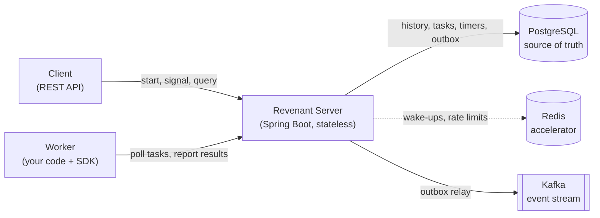

# Revenant

> A crash-proof workflow engine for long-running processes. Kill a worker mid-flight, restart it, and every workflow resumes from the exact step where it stopped.

[](https://github.com/Amitreddy14/revenant/actions/workflows/ci.yml)


**Status: Phase 5a (HTTP API and worker SDK).** Activities retry with exponential backoff, workflows can sleep for days with durable timers, and hung activities time out. The server now fires timers by itself and publishes every workflow event to Kafka through a transactional outbox. Redis now carries wake-up hints so workers notice new work quickly, and the engine runs the same without it. Workflows can now be started over HTTP and run by workers written with the Java SDK. The `kill -9` demo comes next (see the [roadmap](#roadmap)).

## Why it exists

Business processes such as order fulfilment, payment recovery and onboarding can last minutes to days and depend on unreliable systems. Normal code keeps its place only in memory, so a crash or a deploy loses it.

Revenant records every step of a workflow as an append-only history. After any failure, a worker re-runs the workflow code and the SDK answers already-completed steps from the history instead of doing them again, so execution continues at the first step that never finished. This is *durable execution*, the same idea behind Temporal and Azure Durable Functions, implemented from scratch here to show how it works.

## How it fits together



PostgreSQL holds all state that matters. Redis only makes things faster and Kafka only publishes events outward, so losing either never loses a workflow. Details are in [docs/design.md](docs/design.md).

## Quick start (Windows PowerShell)

Requirements: JDK 21, Docker Desktop (it must be running, the tests start their own PostgreSQL), Git.

```powershell
# 1. Start PostgreSQL, Redis and Kafka
docker compose up -d
docker compose ps            # wait until all three show "healthy"

# 2. Build and run the tests (starts a throwaway PostgreSQL container)
.\gradlew.bat build

# 3. Start the server (applies the database migrations on startup)
.\gradlew.bat :revenant-server:bootRun

# 4. In a second terminal, check it is alive
curl.exe http://localhost:8080/actuator/health
```

Expected health response: `{"status":"UP"}` (the exact JSON may include more fields).

Workflow events are published to the Kafka topic `revenant.workflow-events`. To watch them (any workflow started against the database shows up here):

```powershell
docker exec -it revenant-kafka /opt/kafka/bin/kafka-console-consumer.sh --bootstrap-server localhost:9092 --topic revenant.workflow-events --from-beginning --property print.key=true --property print.headers=true
```

Without Kafka, start the server with `--revenant.kafka.enabled=false`; the engine works the same. Redis is optional in the same way (`--revenant.redis.enabled=false`), and the server starts fine with Redis stopped.

Stop everything with `docker compose down` (add `-v` to also delete the data).

## Securing the API

By default the API is open, which is convenient on your laptop. Before exposing the server, set API keys (each at least 16 characters, comma separated so you can rotate them) and make the server refuse to start without them:

```powershell
$env:REVENANT_API_KEYS = "paste-a-long-random-key-here"
$env:REVENANT_SECURITY_REQUIRED = "true"
.\gradlew.bat :revenant-server:bootRun
```

Clients and workers then send `Authorization: Bearer <key>`. In Java: `new RevenantClient(url, apiKey)`. A missing or wrong key gets `401`; `/actuator/health` stays open for probes. Use HTTPS in front of the server, since the key travels in a header. Details and limits are in [ADR-0014](docs/adr/0014-api-key-authentication.md).

The demo worker reads its key from the environment variable `REVENANT_API_KEY`. The `kill -9` demo script starts its own server with authentication off.

## Writing a workflow and a worker

A workflow is ordinary Java. Each `callActivity` is remembered in the history, so after a crash the code runs again from the top and the finished calls return their recorded results instead of running twice.

```java
RevenantClient client = new RevenantClient("http://localhost:8080");

WorkflowDefinition order = (ctx, input) -> {
    String charge = ctx.callActivity("charge", input);
    return ctx.callActivity("ship", charge);
};

Worker worker = Worker.builder(client)
        .workflow("Order", order)
        .activity("charge", in -> "{\"charged\":true}")
        .activity("ship", in -> "{\"tracking\":\"T-1\"}")
        .build();
worker.start();

WorkflowId id = client.startWorkflow("Order", "{\"orderId\":7}");
```

The same API is available over plain HTTP (see [ADR-0013](docs/adr/0013-http-api-and-worker-protocol.md)):

```powershell
curl.exe -X POST "http://localhost:8080/api/v1/workflows?type=Order" -H "Content-Type: application/json" -d "{}"
curl.exe http://localhost:8080/api/v1/workflows/<workflowId>
```

## Demo: `kill -9` a worker mid-flight

The `revenant-demo` module has an order workflow: **charge the card, reserve stock, ship (slow, about 6 seconds), send a receipt**. Every step appends a line to a ledger file, so you can see exactly what really ran.

```powershell
docker compose up -d
powershell -ExecutionPolicy Bypass -File .\scripts\demo-kill-worker.ps1
```

The script starts the server and worker A, starts an order, waits until shipping has begun, then kills worker A with no warning (`Stop-Process -Force`, the Windows twin of `kill -9`). It then starts worker B, which knows nothing about A, and waits for the workflow to finish.

What you should see:

| Step | Times it ran | Why |
|---|---|---|
| charge | 1 | finished and recorded before the crash, so it is answered from history on replay |
| reserve stock | 1 | same |
| ship (started) | 2 | it was interrupted, so it runs again once the dead worker's 10 s lease expires |
| ship (done) | 1 | only the second attempt finished |
| receipt | 1 | runs after shipping completed |

The script ends with `PASS` or `FAIL` for each count. Note the honest guarantee: Revenant gives **at-least-once** execution of an interrupted activity, and **exactly-once recording** of its result. The interrupted step must be safe to repeat, which is why the demo derives its ids from the order id (idempotency). Logs are written to `demo-logs/`. See [docs/demo.md](docs/demo.md) for the timeline.

## Deploying it for free

`deploy/` holds a production-style stack: PostgreSQL, Redis, the server and a Caddy proxy that serves HTTPS, with API keys required and only ports 80 and 443 open. [docs/deploy.md](docs/deploy.md) walks from creating a free Oracle Cloud account to running the `kill -9` demo on a public server (`scripts/demo-kill-worker.sh`). The container images build in CI; the full deployment is something you prove once on your own VM. Design: [ADR-0016](docs/adr/0016-single-vm-docker-compose-deployment.md).

## Repository layout

```
revenant/
├── revenant-core/          pure engine logic: history, replay (Decider), retry policy, no dependencies
├── revenant-persistence/   SQL migrations, JDBC repositories, transactions (no Spring)
├── revenant-worker-sdk/    the library workflow authors depend on
├── revenant-server/        Spring Boot application
├── revenant-demo/          order workflow + worker for the kill -9 demo
├── deploy/                 production compose file, Caddyfile, .env.example
├── Dockerfile              server and demo-worker images
├── scripts/                demo-kill-worker.ps1 (Windows), demo-kill-worker.sh (the VM)
├── docs/
│   ├── design.md           architecture, failure model, semantics
│   └── adr/                architecture decision records
├── docker-compose.yml      PostgreSQL, Redis, Kafka for local development
└── .github/workflows/      CI
```

## Roadmap

| Phase | Deliverable | Status |
|---|---|---|
| 0 | Design doc, ADRs, Gradle scaffold, Docker Compose, CI | Done |
| 1 | PostgreSQL schema, Flyway migrations, Testcontainers | Done |
| 2 | Event-sourced history and the replay core | Done |
| 3 | Retries, timers, timeouts, failure handling | Done |
| 4a | Background scheduler and Kafka outbox relay | Done |
| 4b | Redis task wake-ups (accelerator only) | Done |
| 5a | HTTP API and worker SDK | Done |
| 5b | Demo workflow that survives `kill -9` | Done |
| 6a | API key authentication, heartbeat design | Done |
| 6b | Free deployment files and guide (Oracle Cloud Always Free) | Done |

## Contributing and Git workflow

Short-lived branches named `phase-N-topic`, Conventional Commit messages, pull requests into `main`, and a tag at the end of each phase. See [CONTRIBUTING.md](CONTRIBUTING.md).

## License

MIT. See [LICENSE](LICENSE).
