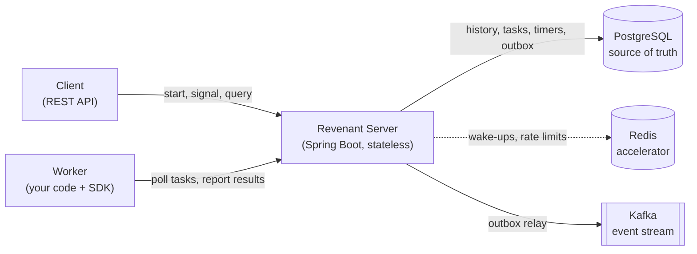

# Revenant

> A crash-proof workflow engine for long-running processes. Kill a worker mid-flight, restart it, and every workflow resumes from the exact step where it stopped.

[](https://github.com/Amitreddy14/revenant/actions/workflows/ci.yml)


**Status: Phase 4b (Redis wake-ups).** Activities retry with exponential backoff, workflows can sleep for days with durable timers, and hung activities time out. The server now fires timers by itself and publishes every workflow event to Kafka through a transactional outbox. Redis now carries wake-up hints so workers notice new work quickly, and the engine runs the same without it. The worker SDK comes next (see the [roadmap](#roadmap)).

## Why it exists

Business processes such as order fulfilment, payment recovery and onboarding can last minutes to days and depend on unreliable systems. Normal code keeps its place only in memory, so a crash or a deploy loses it.

Revenant records every step of a workflow as an append-only history. After any failure, a worker re-runs the workflow code and the SDK answers already-completed steps from the history instead of doing them again, so execution continues at the first step that never finished. This is *durable execution*, the same idea behind Temporal and Azure Durable Functions, implemented from scratch here to show how it works.

## How it fits together



PostgreSQL holds all state that matters. Redis only makes things faster and Kafka only publishes events outward, so losing either never loses a workflow. Details are in [docs/design.md](docs/design.md).

## Quick start (Windows PowerShell)

Requirements: JDK 21, Docker Desktop (it must be running, the tests start their own PostgreSQL), Git.

```powershell
# 1. Start PostgreSQL, Redis and Kafka
docker compose up -d
docker compose ps            # wait until all three show "healthy"

# 2. Build and run the tests (starts a throwaway PostgreSQL container)
.\gradlew.bat build

# 3. Start the server (applies the database migrations on startup)
.\gradlew.bat :revenant-server:bootRun

# 4. In a second terminal, check it is alive
curl.exe http://localhost:8080/actuator/health
```

Expected health response: `{"status":"UP"}` (the exact JSON may include more fields).

Workflow events are published to the Kafka topic `revenant.workflow-events`. To watch them (any workflow started against the database shows up here):

```powershell
docker exec -it revenant-kafka /opt/kafka/bin/kafka-console-consumer.sh --bootstrap-server localhost:9092 --topic revenant.workflow-events --from-beginning --property print.key=true --property print.headers=true
```

Without Kafka, start the server with `--revenant.kafka.enabled=false`; the engine works the same. Redis is optional in the same way (`--revenant.redis.enabled=false`), and the server starts fine with Redis stopped.

Stop everything with `docker compose down` (add `-v` to also delete the data).

## Repository layout

```
revenant/
├── revenant-core/          pure engine logic: history, replay (Decider), retry policy, no dependencies
├── revenant-persistence/   SQL migrations, JDBC repositories, transactions (no Spring)
├── revenant-worker-sdk/    the library workflow authors depend on
├── revenant-server/        Spring Boot application
├── docs/
│   ├── design.md           architecture, failure model, semantics
│   └── adr/                architecture decision records
├── docker-compose.yml      PostgreSQL, Redis, Kafka for local development
└── .github/workflows/      CI
```

## Roadmap

| Phase | Deliverable | Status |
|---|---|---|
| 0 | Design doc, ADRs, Gradle scaffold, Docker Compose, CI | Done |
| 1 | PostgreSQL schema, Flyway migrations, Testcontainers | Done |
| 2 | Event-sourced history and the replay core | Done |
| 3 | Retries, timers, timeouts, failure handling | Done |
| 4a | Background scheduler and Kafka outbox relay | Done |
| 4b | Redis task wake-ups (accelerator only) | Done |
| 5 | Worker SDK and a demo workflow that survives `kill -9` | Next |
| 6 | Free deployment, documentation, demo | Planned |

## Contributing and Git workflow

Short-lived branches named `phase-N-topic`, Conventional Commit messages, pull requests into `main`, and a tag at the end of each phase. See [CONTRIBUTING.md](CONTRIBUTING.md).

## License

MIT. See [LICENSE](LICENSE).
