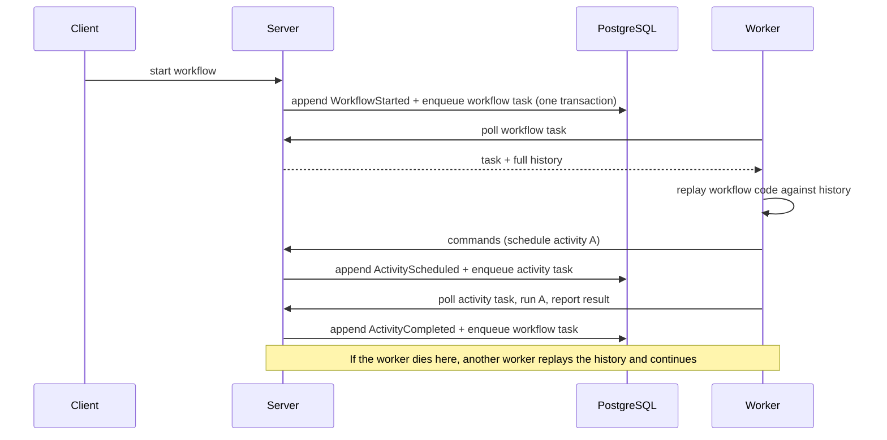
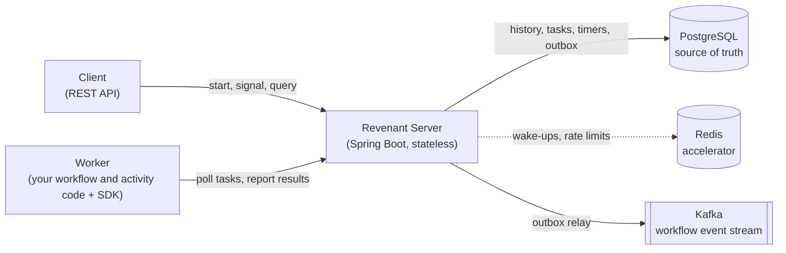
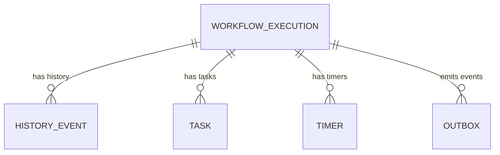
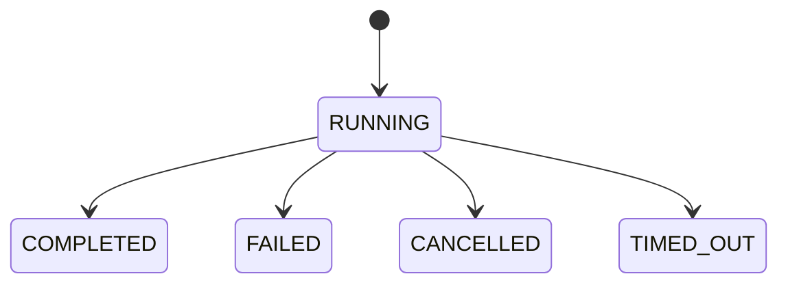
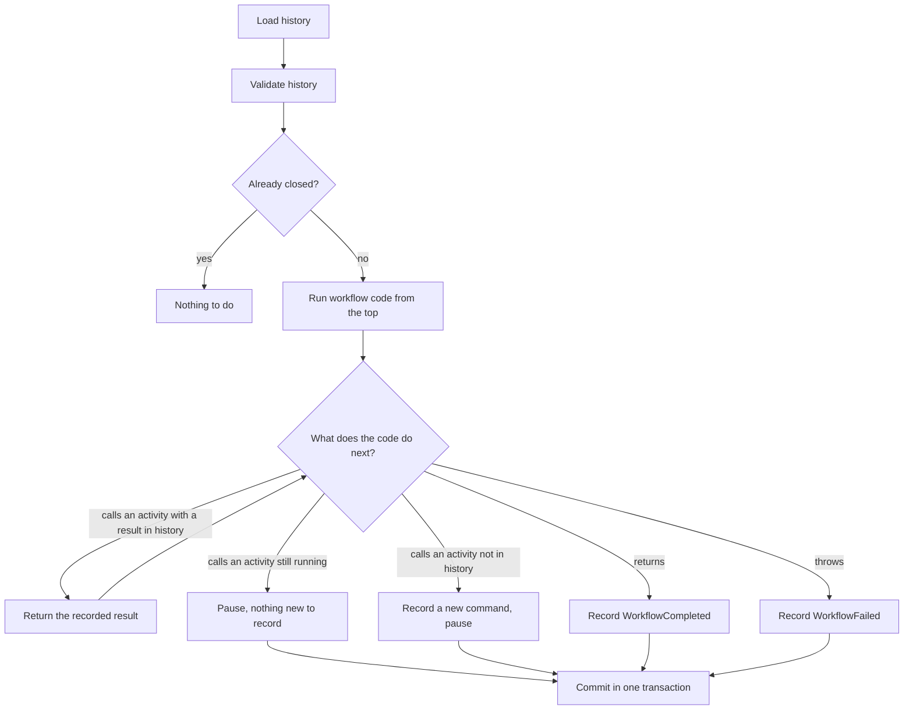

# Revenant: Design Document

Status: Phase 0 draft. Details marked *(Phase N)* are finalised in that phase and may change; the decisions in `docs/adr/` are locked unless a new ADR supersedes them.

## 1. Problem

A long-running process (an order that waits for payment, a refund that retries for days, an onboarding that pauses for human approval) outlives any single program run. Servers restart, deploys happen, networks drop. Ordinary code keeps its place only in memory, so when the process dies, the work is lost or half-done.

Revenant is a workflow engine that makes such processes **durable**: a workflow can be interrupted at any instruction, on any machine, and later continue from the exact step where it stopped, without repeating completed work.

## 2. Goals and non-goals

**Goals**

1. Survive crashes of workers, of engine instances, and of Redis and Kafka, without losing or corrupting workflow state.
2. Resume from the exact point of failure: completed steps are never re-executed.
3. First-class retries with backoff, timeouts and durable timers (sleeps that last days).
4. Workflows written as ordinary Java code, not as a diagram or YAML.
5. Observable and operable: health checks, metrics, event stream, clear failure reasons.

**Non-goals**

- Multi-tenancy, authentication and a web UI (possible later, not part of the core).
- A second language SDK (ADR-0006).
- Competing with Temporal on scale. Target is thousands of tasks per second on one PostgreSQL, not millions.

## 3. Core idea: record decisions, replay them

Think of a video game save file. Instead of freezing the whole game, Revenant keeps an append-only **history** of everything that happened in a workflow: it started, activity A was scheduled, A returned `42`, a timer was set, and so on.

To resume, a worker runs the workflow code **from the top**, but whenever the code reaches a step that already appears in the history, the SDK returns the recorded result instead of doing the work again. When the code reaches the first step that is *not* in the history, that is the point of failure: real execution continues from there.

This is called **replay**, and it requires one rule: workflow code must be **deterministic** (section 8).

## 4. Vocabulary

| Term | Meaning |
|---|---|
| Workflow | Deterministic Java code describing the process. Its progress is stored as history. |
| Activity | A side-effecting step (call an API, charge a card). May fail and be retried. |
| History | Append-only list of events for one workflow. The single source of truth for its state. |
| Replay | Re-running workflow code against the history to rebuild its in-memory state. |
| Workflow task | "Your workflow has new events, decide what to do next." Handled by a worker. |
| Activity task | "Run this activity." Handled by a worker. |
| Lease | Time-limited ownership of a task by one worker. Expires if the worker goes silent. |
| Outbox | Table of events to publish to Kafka, written in the same transaction as the history. |

## 5. Architecture

| Component | Responsibility | Holds state of record? |
|---|---|---|
| Revenant Server | API, task dispatch, timer service, outbox relay. Stateless: any instance can serve any request. | No |
| PostgreSQL | History, task queue, timers, outbox, workflow metadata. | **Yes** (ADR-0003) |
| Redis | Wake-up notifications so workers do not poll constantly; rate limiting; short-lived caches. | **No** (ADR-0004) |
| Kafka | Outbound stream of workflow events for other systems. | No (ADR-0005) |
| Worker | Runs user code via the SDK. Stateless between tasks. | No |

### Modules (ADR-0007)

| Module | Purpose | Depends on |
|---|---|---|
| `revenant-core` | History, replay, retry policy. Pure Java, no frameworks. | nothing |
| `revenant-persistence` | SQL migrations, plain-JDBC repositories, transactions. No Spring (ADR-0008). | core |
| `revenant-worker-sdk` | What workflow authors import. | core |
| `revenant-server` | Spring Boot app: API, dispatcher, timers, outbox relay. | core, persistence |

## 6. Data model (implemented in Phase 1)

The schema lives in `revenant-persistence/src/main/resources/db/migration/` (`V1__init_schema.sql`, `V2__command_correlation.sql`) and is applied by Flyway.

| Table | Key columns | Notes |
|---|---|---|
| `workflow_execution` | `workflow_id`, `workflow_type`, `status`, `last_seq`, `closed_at` | `last_seq` doubles as the optimistic-lock version. A check constraint ties `closed_at` to `status`. |
| `history_event` | `(workflow_id, seq)` primary key, `event_type`, `command_id`, `name`, `payload` (JSONB) | Append-only: a trigger rejects `UPDATE` and `DELETE`. The primary key makes duplicate appends fail. A unique index on `(workflow_id, command_id, event_type)` stops a command being scheduled or completed twice. |
| `task` | `task_id`, `workflow_id`, `kind`, `command_id`, `name`, `payload`, `attempt`, `visible_at`, `locked_by`, `locked_until` | Claimed with `FOR UPDATE SKIP LOCKED` under a lease. `attempt` is a fencing token. An activity task must carry `command_id` and `name`; a workflow task must not. |
| `timer` | `timer_id`, `workflow_id`, `timer_seq`, `fire_at`, `fired_at` | Partial index on due timers. Timer service arrives in Phase 3. |
| `outbox` | `event_id`, `workflow_id`, `event_type`, `payload`, `published_at` | Written in the same transaction as the history append. Relay arrives in Phase 4. |

### Three mechanisms worth knowing

**Optimistic append.** To append, a writer states the newest sequence number it has seen. The store runs `UPDATE workflow_execution SET last_seq = new WHERE workflow_id = ? AND last_seq = expected AND status = 'RUNNING'`. If another writer got there first, zero rows match and the append fails with `AppendConflictException`, so the caller re-reads and decides again. The primary key on `(workflow_id, seq)` is the second line of defence.

**Leases and fencing.** A worker claims a task by setting `locked_until` in the future and incrementing `attempt`. If the worker dies, the lease runs out and the task becomes claimable again. When a worker reports completion it must present the `attempt` it was given. A worker that lost its lease still holds the old number, so its late report is rejected instead of corrupting the new owner's work.

**One transaction per step.** `WorkflowStore.start` creates the workflow, appends `WorkflowStarted`, writes the outbox row and enqueues the first task in a single transaction. A crash at any point leaves either all four or none.

Workflow status moves one way:

## 7. Failure model

What happens when each part dies, and why nothing is lost:

| Failure | Behaviour | Why it is safe |
|---|---|---|
| Worker dies during an activity | Lease expires without heartbeat, task becomes visible again, another worker retries it. | The task row lives in PostgreSQL. |
| Worker dies during a workflow task | Lease expires, task is reassigned, the new worker replays the history. | History is authoritative; workers hold no state. |
| Server instance dies | Other instances keep serving. The restarted one reads PostgreSQL. | Server is stateless. |
| Redis is lost | Workers fall back to polling PostgreSQL. Slower, still correct. | Redis never holds state of record. |
| Kafka is down | Outbox rows accumulate; the relay catches up when Kafka returns. | The outbox is written in the same transaction as the history. |
| PostgreSQL is down | Engine is unavailable and makes no progress. Nothing is corrupted. Resumes when the database returns. | ACID transactions. |
| A result is reported twice (network retry) | The second report is rejected or ignored. | `(workflow_id, seq)` is unique; task completion is idempotent. |

## 8. Semantics and rules

**Delivery.** Activities run **at least once**: a crash after the side effect but before the result is recorded causes a retry. Workflow *state* changes happen **exactly once**, because history appends are transactional and idempotent. Activity authors should use an idempotency key, for example `workflowId + activityId`, when calling external systems.

**Determinism.** Workflow code runs again on every replay, so it must make the same decisions every time. Inside a workflow, do not read the system clock, generate random numbers, start threads, or call external systems directly. The SDK provides approved replacements (workflow time, workflow random, durable sleep) *(Phase 5)*. During replay the engine compares the activity calls the code makes with the recorded history, by order and by activity name. A mismatch, or code that stops before reaching a recorded call, raises `NonDeterminismException`, which fails the decision *task* (fixable by deploying corrected code), not the workflow. Inputs are deliberately not compared, because PostgreSQL's JSONB rewrites whitespace and key order (ADR-0009).

**Concurrency control.** A history append writes `seq = last_seq + 1`. If two writers race, one violates the primary key and retries after re-reading.

**Retries.** Each activity has a retry policy: initial interval, backoff coefficient, maximum interval, maximum attempts, and a list of non-retryable error types. Timeouts: schedule-to-close, start-to-close and heartbeat. Attempt counters live on the task row, not in the history, so a flapping activity does not bloat the history.

**Ordering.** Kafka events use `workflow_id` as the message key, so consumers see one workflow's events in order. Delivery is at least once; consumers deduplicate by `event_id`.

### How a decision is made (implemented in Phase 2)

`Decider.decide(definition, history)` is a pure function: no database, clock or threads. A worker loads the history, calls it, and hands the result to `WorkflowStore.completeWorkflowTask`.

Two storage operations commit every step, each in a single transaction:

| Operation | Removes | Appends | Queues |
|---|---|---|---|
| `completeWorkflowTask` | the workflow task | the decision's events (and an outbox row for each) | one activity task per new command; closes the workflow if the decision ends it |
| `completeActivityTask` | the activity task | `ActivityCompleted` or `ActivityFailed` (and an outbox row) | a workflow task, so the code can continue |

Both return one of three outcomes. `APPLIED`: recorded. `LEASE_LOST`: the worker's lease expired and the task belongs to someone else, so nothing was written. `STALE_DISCARDED`: the history moved on (or the workflow closed) while the worker was busy, so the result is dropped. That last case is safe because every event that needs a decision queues a workflow task in its own transaction, so a fresher task already exists.

## 9. Roadmap

| Phase | Deliverable | Proves |
|---|---|---|
| 0 | Design doc, ADRs, Gradle scaffold, Docker Compose, CI | The project builds and the infrastructure starts. |
| 1 | PostgreSQL schema, Flyway migrations, Testcontainers | Storage works against a real database. |
| 2 | Event-sourced history and the replay core | Deterministic replay, resume from the exact step. |
| 3 | Retries, timers, timeouts, failure handling | Failures are survivable, not just detectable. |
| 4 | Redis task wake-ups and Kafka event stream | Acceleration and integration without new points of failure. |
| 5 | Worker SDK and a demo workflow that survives `kill -9` | End-to-end crash recovery, demonstrated. |
| 6 | Free deployment, documentation, demo | A running system others can try. |

## 10. Open questions

- **Free deployment target (Phase 6).** Candidate: an Oracle Cloud Always Free VM running Docker Compose. Fallback: local Docker plus a recorded demo. To be decided in Phase 6.
- **Payload serialization.** JSON through Jackson 3 (bundled with Spring Boot 4) is the default. Revisit if payload size becomes an issue.
- **History size limit.** Long-lived workflows need a "continue as new" mechanism. Out of scope until Phase 3 or later.
